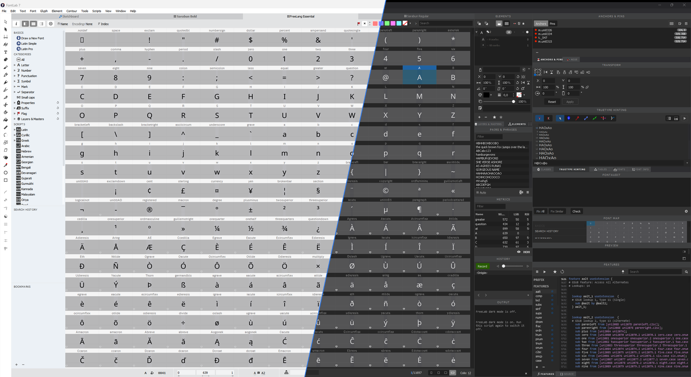
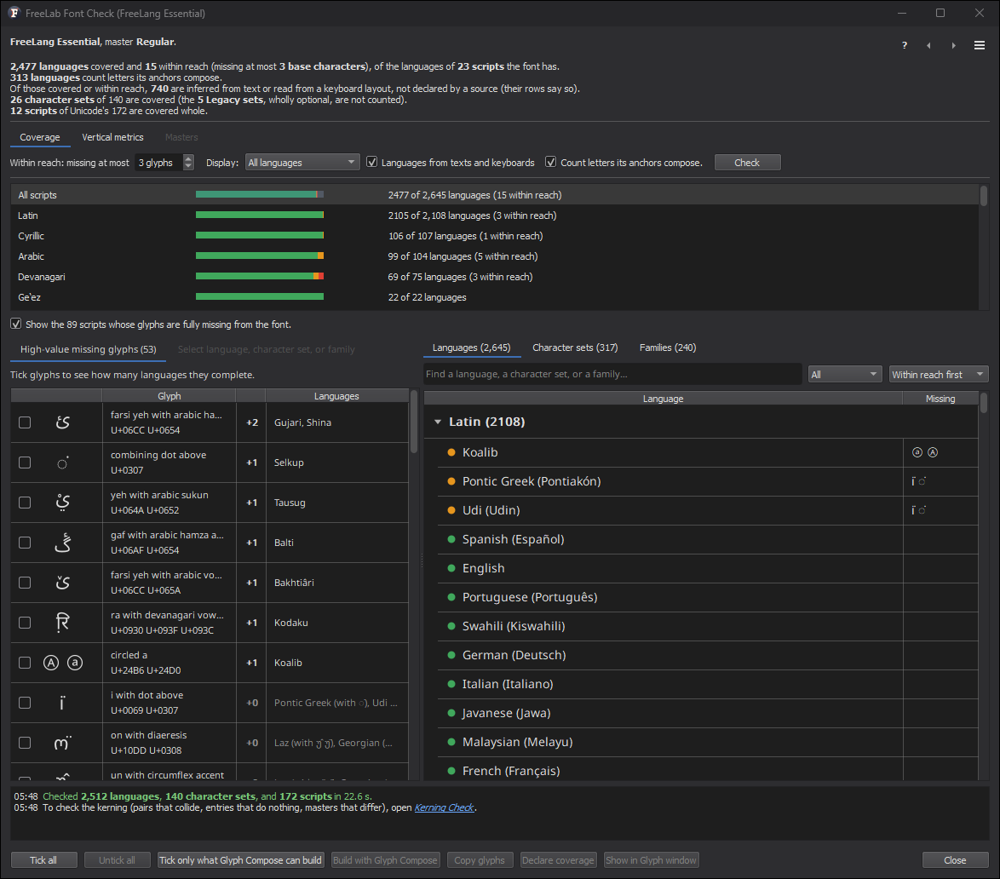
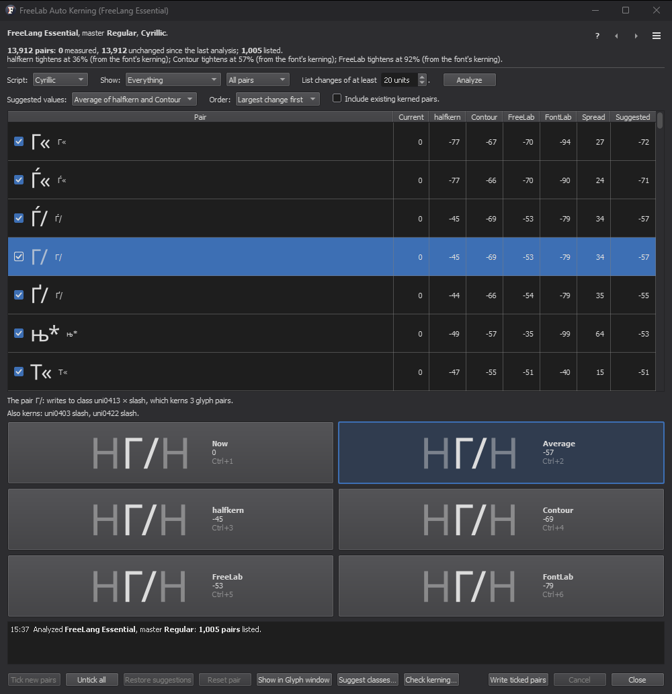
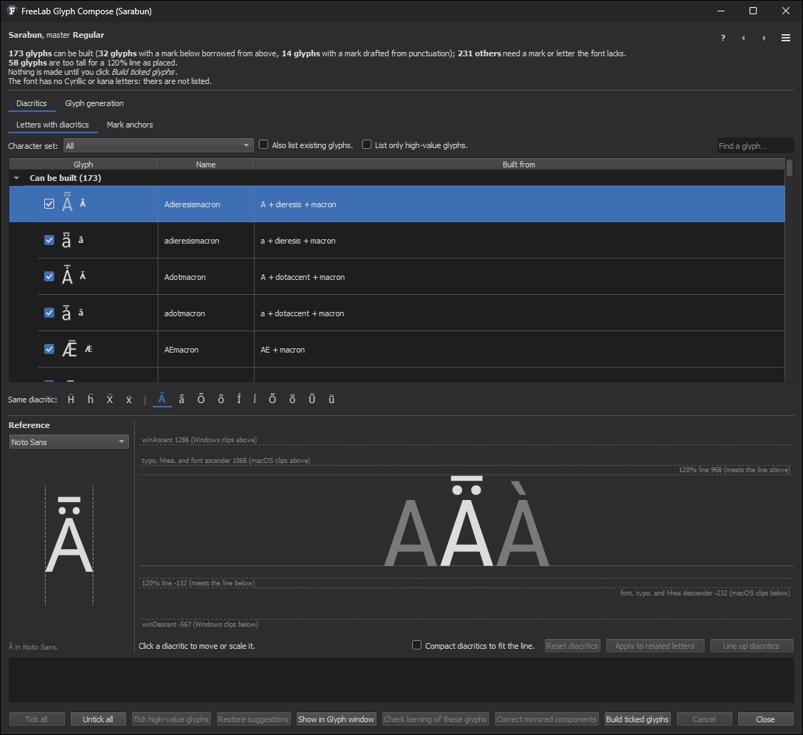
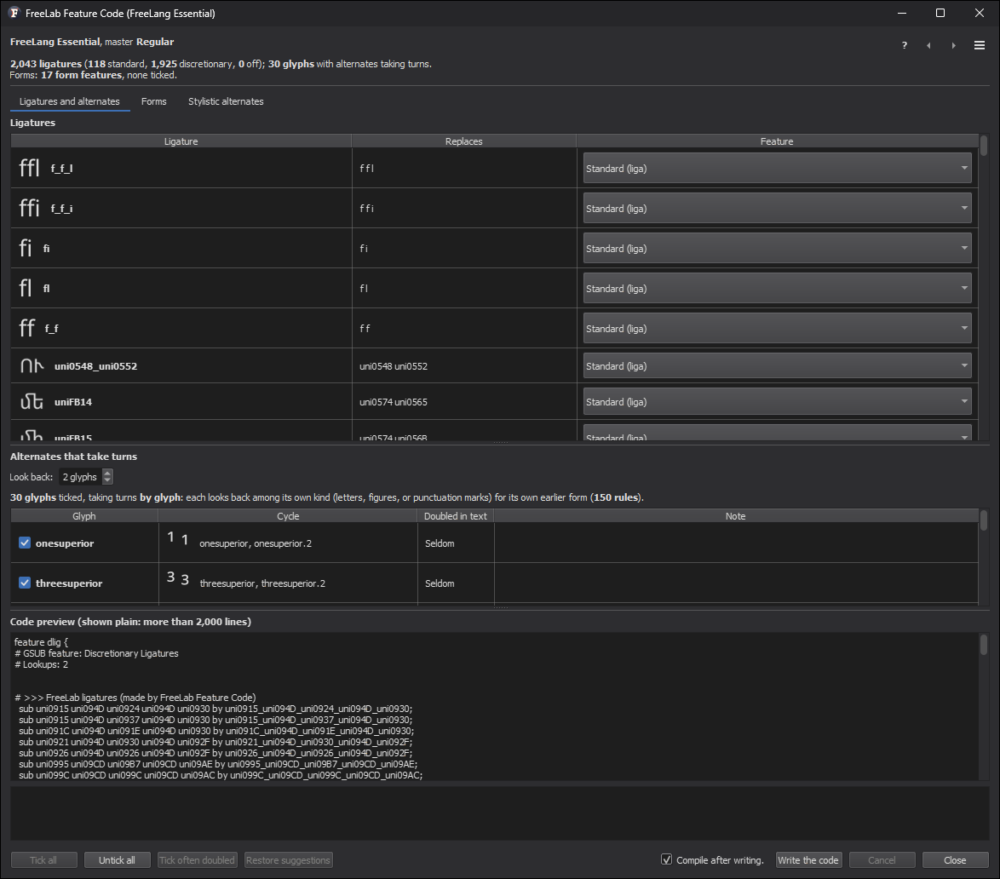
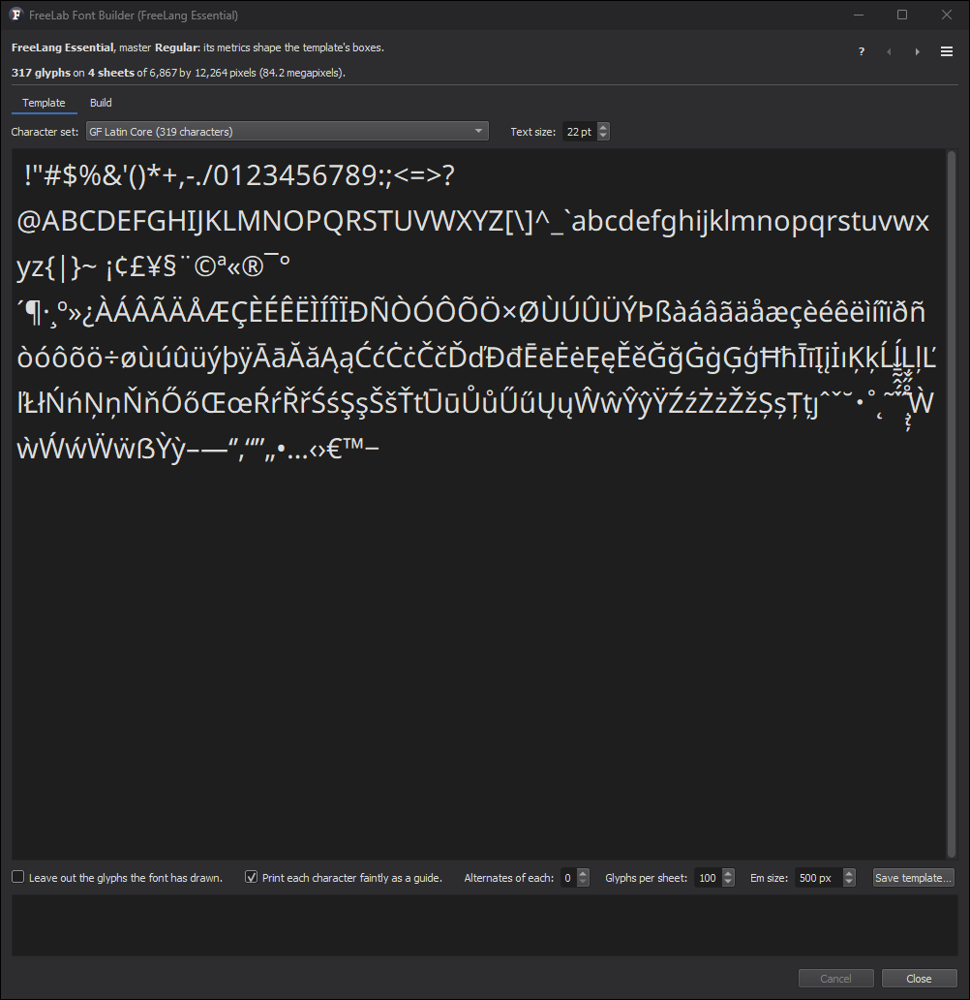
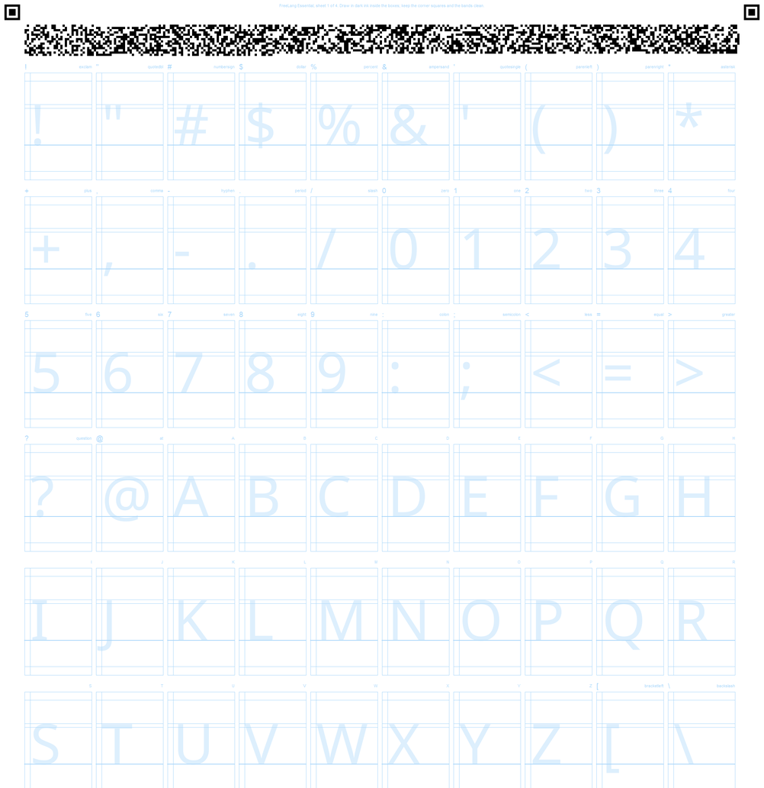
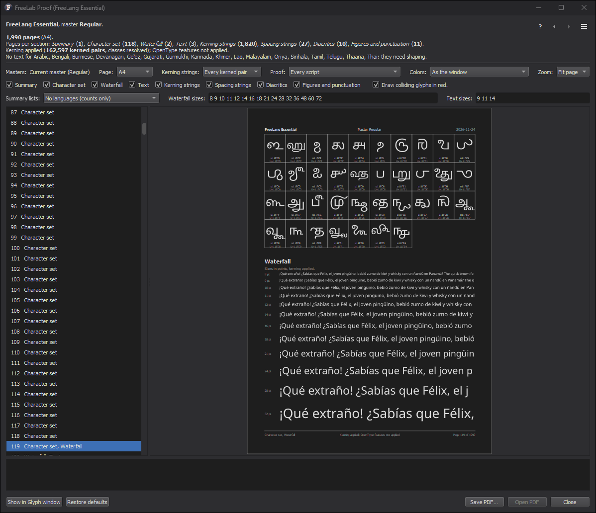

# FreeLab Script Suite

This is a comprehensive script suite for FontLab to help you build and manage your fonts. This is not a clean-room recompilation of FontLab.

It all started because I had wanted a dark theme for FontLab for ages. I was so happy to see that FontLab 8 came with one. I was not so happy when I found out I had to pay an extra $150 on top of the $200 I had already paid a year prior just to qualify for an upgrade. I want the fonts I make to be free, but I don't want to sacrifice the quality of the tools I use to make them. Thanks to the recent boom in AI, I finally had enough power to turn FontLab 7 into what I wish it were. The result of those efforts is what you see here, FreeLab Script Suite.

**Status: 0.3.0.** Every tool below runs in FontLab 7.2 for Windows, and nothing else is planned: the [roadmap](docs/ROADMAP.md) has nothing outstanding, and its known limits say what FreeLab leaves as it is, and why. macOS is not supported.



*Dark Mode*: FontLab 7 as it comes (left) and with FreeLab's dark mode (right), switched without a restart.

> **Dark mode makes FontLab slower.** FontLab 7 has no dark theme of its own, so dark mode redraws much of the interface through its own color mapping. On a fast desktop, switching tabs takes two to three times as long as in light mode with the native engine (180 to 480 ms against 72 to 240; more with the pixel engine, [docs/NATIVE.md](docs/NATIVE.md#the-two-engines)), and scrolling a Font window or editing on a canvas maps each new picture again (40 to 60 ms for a full canvas). On a slower computer this will be felt more. *Mixed* in *Dark Mode Settings* keeps FontLab's light canvases, which are the costliest part, and switching dark mode off needs no restart: [docs/DARKMODE.md](docs/DARKMODE.md#cost).

| | |
|---|---|
|  |  |
| *Font Check*: the languages a font covers and the glyphs that would complete the most of the rest. | *Auto Kerning*: four methods side by side for each pair, previewed before anything is written. |
|  |  |
| *Glyph Compose*: the letters with diacritics a font lacks, built from its own glyphs, each mark placed by hand where needed. | *Feature Code*: ligatures, alternates that take turns, and forms, with the code shown before it is written. |
|  |  |
| *Font Builder*: the characters a template will hold, by set or typed, and how its sheets are laid out. | A template sheet: one box per glyph on the font's own guide lines, each character printed faintly, between the marks that let a drawn sheet be read back. |



*Proof*: a PDF proof from the font's own outlines, here in the window's colors.

## The tools

Each opens from *Scripts > FreeLab* and runs inside FontLab 7.

- *Dark Mode* turns FontLab's whole interface dark and back, without a restart, and remembers the choice; *Dark Mode Settings* chooses dark or automatic (following Windows), mixed (FontLab's light canvases kept), the shade, and the engine (native, which changes FontLab's colors as it paints, or pixels, which changes what it drew): [docs/DARKMODE.md](docs/DARKMODE.md).
- *Auto Kerning* suggests kerning for the current master's pairs, one script at a time, by four methods shown side by side, writes the pairs you approve, and suggests kerning classes (*Suggest classes…*); *Kerning Check* lists colliding pairs, entries that do nothing, and differences between masters: [docs/KERNING.md](docs/KERNING.md).
- *Auto Spacing* suggests sidebearings for the current master's drawn glyphs, measured against the font's own reference glyphs, and changes the glyphs you approve; glyphs built from components follow: [docs/SPACING.md](docs/SPACING.md).
- *Font Builder* makes template sheets to draw glyphs on, in any app or on paper, and builds the glyphs from the sheets drawn, scanned, or photographed, traced into outlines or kept as images: [docs/FONT-BUILDER.md](docs/FONT-BUILDER.md).
- *Glyph Compose* builds the glyphs a font lacks from the glyphs it has: letters with diacritics and the anchors and mark features of scripts that attach marks (*Diacritics* tab), and spaces, dashes, punctuation, look-alikes, fractions, arrows, superscripts and subscripts, signs such as *™* and *№*, circled and full-width forms, kanbun annotation marks, the per mille sign, and other glyphs made of existing ones (*Glyph generation* tab): [docs/GLYPH-COMPOSE.md](docs/GLYPH-COMPOSE.md).
- *CJK Spacing* writes palt and halt for a Japanese font's full-width kana and punctuation, and sets Hangul at one width or proportionally: [docs/CJK.md](docs/CJK.md).
- *CJK Vertical* gives a CJK font what vertical text needs: vertical forms, vpal, vkrn, and vertical metrics, which it adds to a copy of the exported font, since FontLab 7 exports none: [docs/VERTICAL.md](docs/VERTICAL.md).
- *Feature Code* sets each ligature to standard, discretionary, or off, writes alternates that take turns (for handwriting), and writes the features of the font's forms (case, fractions, small caps, figure styles, stylistic sets, and others): [docs/FEATURE-CODE.md](docs/FEATURE-CODE.md).
- *Feature Check* checks any font's feature code for what does not compile, what probably does not do what was meant, and what does nothing, and offers fixes proven to leave the compiled layout as it was: [docs/FEATURE-CHECK.md](docs/FEATURE-CHECK.md).
- *Font Compare* compares two open fonts, or two masters of one font: glyphs, code points, metrics, outlines, components, anchors, kerning, and feature code. It changes nothing: [docs/FONT-COMPARE.md](docs/FONT-COMPARE.md).
- *Family Audit* compares the fonts of a family before they become masters (glyph sets, glyph structure, font info, kerning, and feature code), and *Assemble as masters* makes a new font with a master per source: [docs/FAMILY-AUDIT.md](docs/FAMILY-AUDIT.md).
- *Proof* makes a PDF proof of the current font from its own outlines, for the current master or each one: [docs/PROOF.md](docs/PROOF.md).
- *Font Check* ranks the glyphs to add by the languages they would complete, checks character sets, suggests vertical metrics, and compares the masters' outlines where they do not interpolate: [docs/FONT-CHECK.md](docs/FONT-CHECK.md).
- *Tab Docking* puts a document tab released on or near FontLab's tab bar back in at that place, so tabs reorder by dragging, gives each undocked window a *Dock* button that puts its tabs back, and can keep tabs from being undocked at all (*Tab Docking Settings*); it starts at launch: [docs/WINDOWS.md](docs/WINDOWS.md#tab-docking).
- *Quick Overlay* opens FontLab's *Overlay Fonts* on a new font holding only the glyphs typed or of a flag color, with the family's fonts overlaid, so each change shows at once: on a large font, *Overlay Fonts* takes seconds a change, since FontLab works again on every glyph of the window's font: [docs/QUICK-OVERLAY.md](docs/QUICK-OVERLAY.md).

Each open font has its own FreeLab window, named after it; its tools menu and arrows open the other tools. Writes go into FontLab's History, so *Edit > Undo* takes them back. What every window shares: [docs/WINDOWS.md](docs/WINDOWS.md).

## Requirements

- FontLab 7 for Windows (developed against 7.2.0), with a working **64-bit** Python 2.7. If *Window > Panels > Scripting* cannot run a one-line `print(1)`, fix that first: [docs/PYTHON27.md](docs/PYTHON27.md).
- Windows: macOS is not supported ([docs/INSTALL.md](docs/INSTALL.md#macos)).

## Install

1. Download *FreeLab-Script-Suite-&lt;version&gt;.zip* from the latest [release](https://github.com/VulpesNexus/freelab-script-suite/releases).
2. Quit FontLab, and unpack the archive into FontLab's *Scripts* folder (*Documents\FontLab\FontLab 7\Scripts*, or the *Scripts* folder in the data folder set in FontLab's preferences), so that it holds a *FreeLab* folder.
3. Start FontLab and choose *Scripts > FreeLab > Set Up FreeLab*. It adds FreeLab's block to FontLab's startup script, which arranges the menu and starts tab docking and dark mode with FontLab; chosen again, it offers to take the block out.

Nothing is compiled: the archive holds FreeLab's three native libraries built (the pixel helper, the native dark mode engine, and the auto kerning core), and its fonts.

To install from the source instead, with LLVM (clang) or Visual Studio's C++ tools to build the native libraries: start FontLab once, quit it, and run *tools/install-fontlab.ps1* (`-Uninstall` takes it all out again).

Both ways in full, and what each writes and keeps: [docs/INSTALL.md](docs/INSTALL.md).

## Tests

```
python tests/run_tests.py
```

It runs every suite under Python 3, then the suites of the scripts FontLab runs under Python 2.7, which *tools/get-python27.ps1* fetches; the native libraries must be built. Details: [docs/INSTALL.md](docs/INSTALL.md#tests).

## Limits

- FontLab 7.2 can crash as it opens a font whose `GPOS` holds a single adjustment with no values (Noto Sans JP's and KR's variable fonts, among others), losing the unsaved work in every open font. Family Audit's *Add files…* and Font Compare's *Open a font…* and installed fonts check each file first and offer a fixed copy; FontLab's own *File > Open Fonts* does not, and a WOFF2 is opened unchecked ([docs/FAMILY-AUDIT.md](docs/FAMILY-AUDIT.md#fonts-fontlab-72-crashes-on)).

## More

- [docs/INSTALL.md](docs/INSTALL.md): both ways to install in full, FreeLang's fonts, macOS, and the test gate.
- [docs/WINDOWS.md](docs/WINDOWS.md): what every FreeLab window shares, the menu, and tab docking.
- [docs/FONTLAB-FIXES.md](docs/FONTLAB-FIXES.md): the defects of FontLab itself that FreeLab mends or works around.
- [docs/NATIVE.md](docs/NATIVE.md): dark mode's native engine, which changes FontLab's colors as it paints, and the pixel engine it falls back to.
- Each tool's page, linked above.
- [docs/SOURCES.md](docs/SOURCES.md): the data sources in use, those left out, and those to watch.
- [docs/COVERAGE-GAPS.md](docs/COVERAGE-GAPS.md): what Font Check knows of and does not check.
- [docs/ROADMAP.md](docs/ROADMAP.md): what is done, and the known limits (nothing else is planned).
- [docs/HISTORY.md](docs/HISTORY.md): how the tools got to where they are.
- [docs/FEATURE-SURVEY.md](docs/FEATURE-SURVEY.md): what already exists for dark mode, kerning, diacritics, and feature code.
- [FreeLab MCP](https://github.com/VulpesNexus/freelab-mcp), a separate repository, lets an AI app such as Claude Code read and drive the font open in FontLab. Neither needs the other; installed together, they share *Scripts > FreeLab*, and the MCP's window tools drive FreeLab's windows as a user would ([docs/WINDOWS.md](docs/WINDOWS.md#driving-freelab-with-freelab-mcp)).

## License

**GPL-3.0-or-later** ([LICENSE](LICENSE)). Copyright © 2026 Vixen420. It comes with no warranty.

Auto kerning ports [halfkern](https://github.com/behdad/halfkern)'s method (Copyright 2022 Google LLC, Apache License 2.0), and *kerning/common_pairs.txt* comes from [andre-fuchs/kerning-pairs](https://github.com/andre-fuchs/kerning-pairs) (MIT License, its notice kept in the file). *kerning/script_pairs.txt* counts pairs in public-domain Aozora Bunko works (kana) and Wikipedia text (Armenian and Georgian, CC BY-SA 4.0), as its header says. Font Check's *checks/language_coverage.json* is derived from [Hyperglot](https://github.com/rosettatype/hyperglot) (Apache License 2.0, its notice in *checks/language_coverage_LICENSE*), and its *checks/character_sets.json* from the Unicode Character Database 17.0.0 (Unicode License V3), Google Fonts' glyph sets (Apache License 2.0), and Adobe's Latin, Cyrillic, and Greek character sets (MIT License), their notices in *checks/character_sets_LICENSE*. Its *checks/language_families.json* (the languages' families and other names) is derived from [Glottolog](https://glottolog.org) 5.4 (CC BY 4.0, its notice in *checks/language_families_LICENSE*). The languages Hyperglot does not describe come from *checks/language_orthographies.json*, derived from Google Fonts' language data (Apache License 2.0), Unicode CLDR 49 and Unilex (Unicode License V3), SIL's SLDR (MIT License), An Crúbadán (its word frequencies under CC BY 4.0; its character trigrams of 2010 under the GPL, version 3 or later, as NLTK's data distributes them), the Universal Declaration of Human Rights (public domain, as NLTK's data distributes it), and Language Tools' keyboard layouts (Apache License 2.0), their notices in *checks/language_orthographies_LICENSE*; some of them are inferred from counted text or read from a keyboard layout, and Font Check says which. *docs/SOURCES.md* registers the sources in use, those left out, and those to watch. Glyph Compose names glyphs as glyphsLib's *GlyphData.xml* does (MIT License, Copyright (c) 2016 Georg Seifert, its notice in *compose/GlyphData_LICENSE*); its Glyph generation recipes (*compose/glyph_generation.json*) are FreeLab's own, with character names from the Unicode Character Database (Unicode License V3) and glyph names from GlyphsInfo (BSD 3-Clause License), their notices in *compose/glyph_generation_LICENSE*. The FreeLab method's model, the kerning class counts, Glyph Compose's mark placements and generation layouts, CJK Spacing's trims, and CJK Vertical's forms were learned from fonts under the SIL Open Font License and the Apache License only; only measurements are kept, no font data. CJK Vertical's list of the characters that turn or move in vertical text (*cjk/vertical_model.json*) also takes the Unicode Character Database 17.0.0's Vertical_Orientation property (Unicode License V3, its notice in *checks/character_sets_LICENSE*). The one exception: Font Check, Glyph Compose, and Font Builder use FreeLang, five fonts that fall back to one another, kept here and in each release (*FreeLang-Essential.ttf*, *FreeLang-CJK.ttf*, *FreeLangPlus-General.ttf*, *FreeLangPlus-Mongolian-Tibetan.ttf*, and *FreeLangPlus-Duployan.ttf*, in *checks/language_font*; 31.1 MB together), subsets of 170 Noto fonts, Andika, Kanchenjunga, Kedebideri, Padauk Book, Unicodia Funky, Daarage, Shafarik, BabelStone Pseudographica, NewGardiner, Plangothic P1 and P2, and GNU Unifont (SIL Open Font License 1.1, Unifont under the OFL side of its dual license), their notices in *checks/language_font/FreeLang_LICENSE*, holding the characters their lists, tooltips, and pictures of missing glyphs show, so every name, autonym, and character is drawn alike. The fonts are under the SIL Open Font License 1.1, not the GPL: the license above covers FreeLab's code, and *FreeLang_LICENSE* goes wherever the fonts go.

A release's ready-made folder also holds FreeLab's three native libraries built (*darkmode/native/freelab_pixels.c*, *darkmode/native/freelab_hooks.c*, and *kerning/native/freelab_kern.c*, GPL-3.0-or-later as the rest; their source is this repository at the release's tag).
